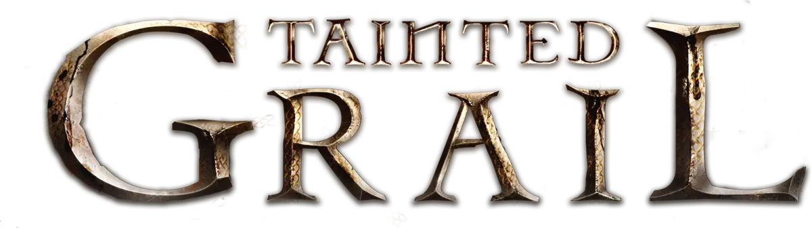

# Tainted Grail Save Sheet Tracker

<p align="center">
  
</p>

A responsive digital save sheet for tracking a *Tainted Grail* campaign during play.

> **Published application:** [Tainted Grail Save Sheet Tracker](https://paoloiulita.github.io/tainted-grail-tracker/)

## Current release scope

- **Fall of Avalon** is the only playable campaign. Last Knight, Age of Legends, Red Death, and Kings of Ruin are shown as coming soon.
- The interface is currently available in English. The app uses i18next; additional translations can be added later.
- Campaign progress is saved automatically in the browser's local storage.
- Save History supports named snapshots, restore, and delete.
- Offline Backup downloads all local storage entries as JSON and can import a validated backup. Import replaces all local storage for this site in the current browser and should be treated as destructive.
- The layout supports desktop, tablet, and mobile screens.

## Asset notice

All *Tainted Grail* game artwork, logos, character images, and other game-related assets used in this project are the property of Awaken Realms. This project is an unofficial fan-made tool and is not affiliated with or endorsed by Awaken Realms.

## Fall of Avalon tracker

The campaign includes:

- Chapter and day tracking
- Three Menhirs, two quest dials, and two Guardian locations
- Up to four character sheets with player names, stats, resources, and attributes
- 71 statuses with their box counts, enumeration, and status captions
- 16 removed-location rows
- Campaign notes

## Run locally

Requirements: Node.js `^20.19.0` or `>=22.12.0` and npm.

```sh
git clone https://github.com/paoloiulita/tainted-grail-tracker.git
cd tainted-grail-tracker
npm ci
npm run dev
```

Vite prints the local development URL when the server starts.

## Checks and production build

```sh
npm run lint
npm run type-check
npm test
npm run build
```

The production files are written to `dist/`. To serve that build locally, run `npm run preview`.

## Deployment

The GitHub Actions workflow in `.github/workflows/gh-pages.yml` runs lint, type-check, tests, and a production build for pull requests and pushes to `main`. It deploys to GitHub Pages on pushes to `main`, provided Pages is configured to use GitHub Actions.

## Project structure

```text
src/
├── campaigns/
│   └── fallOfAvalon/
│       ├── FallOfAvalonCampaign.tsx
│       ├── statusDefinitions.ts
│       └── statusDefinitions.test.ts
├── components/       # Shared UI, campaign selector, saves, and notes
├── contexts/         # Shared campaign context
├── hooks/            # Campaign registry and local-storage state
├── locales/
│   └── en.json       # Active English translations
├── localStorageBackup.ts
├── App.tsx
├── index.css
├── main.tsx
└── types.ts
public/assets/         # Campaign art, character portraits, icons, and fonts
```

See [CONTRIBUTORS.md](./CONTRIBUTORS.md) for development and contribution guidance.

## License

The application source code is released under the [MIT License](./LICENSE). Third-party assets, including *Tainted Grail* artwork and logos, are excluded and remain the property of their respective owners.
